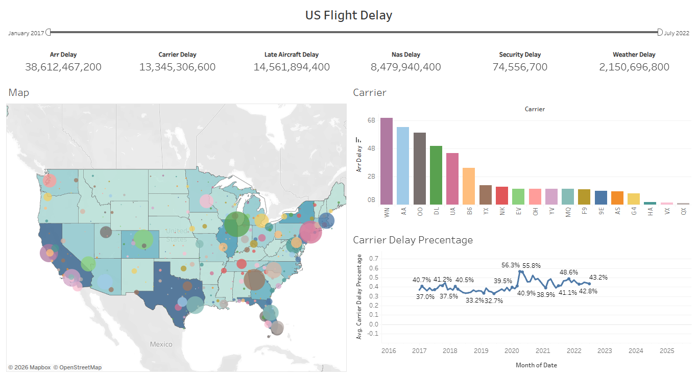

# US Flight Delay Analysis & Interactive Dashboard

An interactive Tableau dashboard project exploring US flight delays, airline operational performance, and monthly delay patterns.

## Project Overview

This project analyzes approximately 101,000 rows of US flight delay data to explore arrival delays across airlines, states, cities, and time periods. Microsoft Excel was used to clean and prepare the data, while Tableau Public was used to create an interactive dashboard for visual analysis.

**Tools:** Microsoft Excel | Tableau Public

**Project Type:** Dummy / Practice Project

## Tools & Skills

- Microsoft Excel
- Tableau Public
- Data Cleaning & Preparation
- Geographic Analysis
- Trend Analysis
- Data Visualization
- Interactive Dashboard Development

## Project Process

1. **Data Preparation:** Cleaned and transformed approximately 101,000 rows of data by combining year and month fields, separating airport location information, standardizing text spacing, and removing unused columns.
2. **Operational Analysis:** Visualized arrival delays by state and city, compared total arrival delays across airlines, and explored different delay categories.
3. **Trend Analysis:** Created a monthly line chart to examine carrier-related delays as a percentage of arrival delays.
4. **Dashboard Development:** Built an interactive Tableau dashboard featuring a geographic map, airline comparison chart, monthly trend, and delay summary, with filters for location, airline, and date.

## Dashboard Preview

## Key Analysis Areas

- **Geographic Patterns:** Explore arrival delays across states and cities.
- **Airline Performance:** Compare total arrival delays across airlines.
- **Delay Categories:** Examine different categories of flight delays.
- **Monthly Trends:** Track carrier-related delays as a percentage of arrival delays over time.

## Dashboard Features

- Geographic map for exploring delays by location.
- Airline comparison chart.
- Monthly trend visualization.
- Summary of flight delay metrics.
- Interactive filters for location, airline, and date.

## Interactive Dashboard

[**View Interactive Dashboard on Tableau Public**](https://public.tableau.com/views/Book1_17929391742870/USFlightDelay?:language=en-US&publish=yes&:sid=&:redirect=auth&:display_count=n&:origin=viz_share_link)

## Project Purpose

This practice project demonstrates the use of Excel for data preparation and Tableau Public for interactive visualization. It focuses on exploring flight delay patterns and comparing airline operational performance through geographic, categorical, and time-based analysis.
